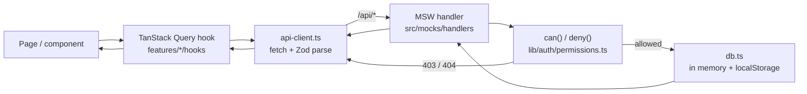
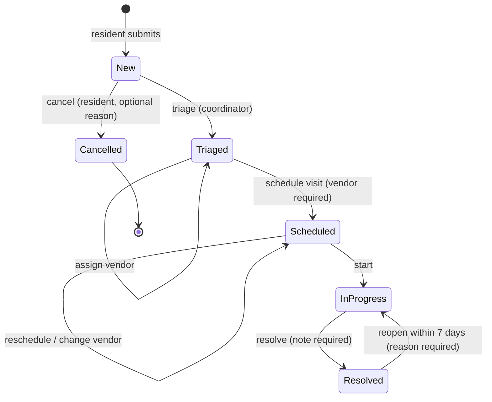
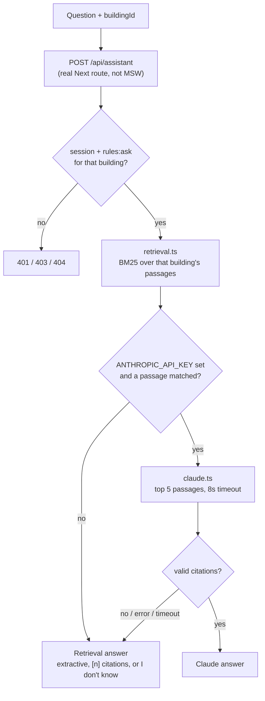

# Application flow

How Keyway works end to end: who does what, how data moves, and the rules that keep each building's data separate.

## Roles and their flows

| Role                 | Signs in to  | Main flow                                                                                                                                                                                                   |
| -------------------- | ------------ | ----------------------------------------------------------------------------------------------------------------------------------------------------------------------------------------------------------- |
| **Resident**         | `/requests`  | Submit a request for their own unit (`/requests/new`), follow its status and timeline, message the coordinator on the request, ask the house-rules assistant for their building.                            |
| **Coordinator**      | `/requests`  | Work the queue for the active building (filters, search, sort in the URL), open a request, triage, assign a vendor, schedule a visit window, mark in progress, resolve; message residents; switch building. |
| **Property manager** | `/dashboard` | See the portfolio: open requests by building, time to resolve, overdue by urgency, coordinator workload (each chart has a table view). Browse requests per building and ask the assistant.                  |

Sign-in is a demo people picker (`src/features/session/components/SignInScreen.tsx`). It sets a session cookie `role.userId.activeBuildingId`. `src/proxy.ts` reads that cookie to gate routes before render: signed-out visitors go to `/sign-in?next=...` (only same-origin `next` values are followed), and a role without access gets the no-access page.

## Data flow

1. A component calls a hook such as `useRequests()` or `useWorkflowAction()`. Query keys for building-scoped data include the `buildingId`, so a switch can never show another building's cache.
2. The hook calls a fetcher in `features/<feature>/api.ts`, which uses `api.get/post/put/delete` from `src/lib/api-client.ts`. Every response is parsed with the entity's Zod schema; errors become a typed `ApiError` (problem details).
3. In the browser, Vitest, Storybook and Cypress, the same MSW handlers answer `/api/*`. Each handler reads the session cookie, looks up the resource, and calls `deny(user, action, resource)`: **404** when the resource is outside the user's scope (so its existence isn't leaked), **403** when the role can't do the action. Bodies are validated with the same Zod schemas (**422**), and status changes go through the state machine (**409**).
4. Writes go through `updateDb()`, which persists to `localStorage` so the demo survives a reload. Ownership fields (unit, building, resident) always come from the session, never the request body.
5. Mutations update the cache optimistically where it helps (workflow steps, sending a message), roll back with a toast on failure, and invalidate the affected keys on success.

`src/lib/auth/permissions.ts` is the only place rules live. `proxy.ts` uses `roleCan()` for routes, components use `can()` to hide controls, and handlers use `deny()` to enforce them.

## Request status state machine

The table lives in `TRANSITIONS` in `src/features/requests/schema.ts`. Resolved and Cancelled are closed (`isOpenStatus()`), so they leave open counts, overdue and the staff queue's default view. `nextStatus()` decides what's allowed, and `canStillReopen()` adds the 7-day window (409 `REOPEN_WINDOW_CLOSED` after it); the detail page only offers the next valid steps, and the API returns 409 for anything else. Each step appends a timeline event with the previous and new status. Visit windows are validated in the building's time zone (1 to 4 hours, 8:00 to 20:00 unless it's an emergency) by the same function in the form and the API.

## House-rules assistant

- The corpus is filtered to the requested building before anything else, so answers can only cite that building's rules.
- Retrieval (`src/features/house-rules/retrieval.ts`) scores passages, composes an extractive answer with `[1] [2]` citations, and says "I don't know" below a threshold.
- Claude mode (`src/features/house-rules/claude.ts`, server-only) sends only the top passages, strips `<` and `>` from the question, and rejects any answer that cites nothing or cites a passage it wasn't given. Any failure falls back to the retrieval answer. The UI shows an "Answer mode" badge.

## Roles and permissions (summary)

| Action                           | Resident     | Coordinator                 | Manager                     |
| -------------------------------- | ------------ | --------------------------- | --------------------------- |
| List / view requests             | Own unit     | Active building             | Any building                |
| Create a request                 | Own unit     | No                          | No                          |
| Triage, schedule, start, resolve | No           | Covered buildings           | No                          |
| Assign a vendor                  | No           | Covered buildings           | Yes (UI not built yet, 2.9) |
| Message on a request             | Own requests | Covered buildings           | No                          |
| Ask the house rules              | Own building | Covered buildings           | Any building                |
| Switch building                  | No           | If they cover more than one | Yes                         |
| Dashboard                        | No           | No                          | Yes                         |

The full matrix and its tests: `docs/spec/product-spec.md` and `src/lib/auth/permissions.test.ts`.
